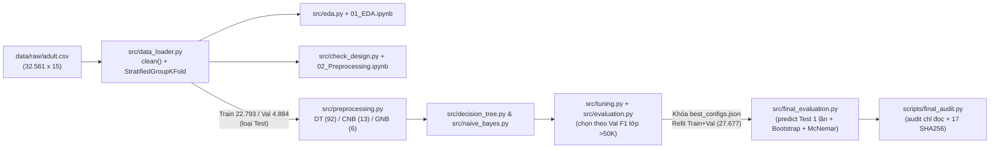

# So sánh Decision Tree và Naive Bayes – Adult Census Income

Dự án môn Machine Learning: dự đoán một người có thu nhập `>50K` USD/năm hay không (phân loại nhị phân), so sánh **Decision Tree** và **Categorical Naive Bayes** theo một quy trình thực nghiệm chống rò rỉ dữ liệu và có kiểm toán lại.

## Kết quả chính (tập Test, 4.884 mẫu)

| Mô hình | Accuracy | Precision | Recall | F1 | ROC-AUC | AP |
|---|---|---|---|---|---|---|
| Decision Tree | 0,8022 | 0,5576 | 0,8639 | 0,6778 | 0,8984 | 0,7715 |
| CategoricalNB | 0,8176 | 0,5907 | 0,7891 | 0,6756 | 0,9011 | 0,7665 |

- Khoảng tin cậy bootstrap 95% của chênh lệch DT − CNB đều chứa 0 (F1 [−0,0133; +0,0175]), nên **chưa đủ bằng chứng để kết luận mô hình nào tốt hơn**. Điều này cũng không chứng minh hai mô hình tương đương.
- Hai mô hình đánh đổi khác nhau: DT có Recall cao hơn; CNB có Precision và Accuracy cao hơn.

---

## Luồng dữ liệu và kiến trúc source code



**Quan hệ phụ thuộc giữa các module trong `src/`:**
- `data_loader.py` & `evaluation.py`: tầng nền độc lập, không import module nội bộ nào.
- `preprocessing.py` & `eda.py`: chỉ import từ `data_loader.py`.
- `decision_tree.py`: import từ `data_loader.py` và `preprocessing.py`.
- `naive_bayes.py`: import từ `preprocessing.py`.
- `check_design.py`: import từ `data_loader.py` và `preprocessing.py`.
- `tuning.py` & `final_evaluation.py`: tầng điều phối, import `data_loader`, `decision_tree`, `naive_bayes`, `evaluation`.

---

## Học dự án theo thứ tự nào?

Đọc theo đúng trình tự của một dự án ML. Mỗi bước ghi rõ **đọc file nào** và **cần hiểu được gì** trước khi sang bước sau.

### Bước 0 – Bản đồ tổng quan (15 phút)
- [`results/reports/course_report/LEARNING_ROADMAP.md`](results/reports/course_report/LEARNING_ROADMAP.md): đọc phần "Bức tranh toàn cảnh" và 3 câu chốt.
- [`results/reports/course_report/GIT_COMMIT_GUIDE.md`](results/reports/course_report/GIT_COMMIT_GUIDE.md): danh sách commit ứng với từng giai đoạn.

> `LEARNING_ROADMAP.md` là tài liệu học chính: mỗi giai đoạn có lý thuyết, giải thích code, lỗi thường gặp, câu hỏi bảo vệ và bài tập. README này chỉ là lộ trình đọc file.

### Bước 1 – Môi trường
| File | Cần hiểu |
|---|---|
| `requirements.txt` | Vì sao ghim phiên bản thư viện; seed 42 dùng ở đâu |
| `.gitignore` | File nào không đưa vào Git |

### Bước 2 – Dữ liệu
| File | Cần hiểu |
|---|---|
| `data/raw/adult.csv` | 32.561 dòng, 15 cột; giá trị thiếu ghi bằng `?`. **Không sửa file này.** |
| `src/data_loader.py` | `clean()`; danh sách đặc trưng; vì sao bỏ `education`; `split_data()` |

### Bước 3 – Khám phá dữ liệu (EDA)
| File | Cần hiểu |
|---|---|
| `notebooks/01_EDA.ipynb` | Mất cân bằng lớp (24% `>50K`), dữ liệu thiếu, phân phối lệch của capital |
| `src/eda.py` | Cách tính Pearson, Cramér's V (hiệu chỉnh Bergsma), Mutual Information |
| `results/eda/*.csv`, `results/figures/eda/` | Bảng và hình kết quả |

Lưu ý: EDA chạy trên toàn bộ dữ liệu trước khi chia tập – đây là hạn chế đã ghi nhận.

### Bước 4 – Chia tập và tiền xử lý
| File | Cần hiểu |
|---|---|
| `src/data_loader.py` (`split_data`) | StratifiedGroupKFold: Train 22.793 / Val 4.884 / Test 4.884, giữ bản ghi trùng trong cùng một tập |
| `src/preprocessing.py` | Pipeline DT (One-Hot, 92 đặc trưng) và CNB (quantile binning, `ZeroInflatedDiscretizer`, `SafeOrdinalEncoder`, 13 đặc trưng); vì sao fit trên Train |
| `src/check_design.py` | Kiểm tra 10 giả định thiết kế (chống rò rỉ, tái lập, trạng thái bất biến) |
| `notebooks/02_Preprocessing.ipynb` | Minh họa pipeline |
| `data/processed/` | Chỉ số chia tập và thống kê từng tập |

### Bước 5 – Hai thuật toán
| File | Cần hiểu |
|---|---|
| `src/decision_tree.py` | Entropy/Gini, `max_depth`, `min_samples_*`, `class_weight`, lưới 800 cấu hình |
| `src/naive_bayes.py` | Định lý Bayes, giả định độc lập có điều kiện, `alpha`, `fit_prior`, lưới 126 cấu hình (và thí nghiệm phụ `GaussianNB`) |

### Bước 6 – Đánh giá
| File | Cần hiểu |
|---|---|
| `src/evaluation.py` | Confusion matrix, Precision/Recall/F1, ROC-AUC, AP (cột `pr_auc` thực chất là Average Precision) |

### Bước 7 – Tuning trên Validation
| File | Cần hiểu |
|---|---|
| `src/tuning.py` | Grid search: fit trên Train, chấm trên Val, chọn theo F1 lớp `>50K` |
| `results/metrics/*_validation_grid*.csv`, `best_configs.json`, `validation_comparison.csv` | Toàn bộ cấu hình đã thử và cấu hình được chọn |
| `results/reports/phase4_summary.md` | Tóm tắt giai đoạn tuning |

### Bước 8 – Đánh giá cuối trên Test
| File | Cần hiểu |
|---|---|
| `src/final_evaluation.py` | Refit trên Train+Val, dự đoán Test một lần, bootstrap ghép cặp 5.000 lần, McNemar |
| `results/metrics/final_*.csv`, `bootstrap_confidence_intervals.csv`, `paired_model_comparison.csv` | Kết quả Test đã đóng băng |
| `results/reports/final_evaluation.md` | Diễn giải kết quả |

### Bước 9 – Kiểm toán
| File | Cần hiểu |
|---|---|
| `scripts/final_audit.py` | Audit chỉ đọc: không fit, không predict |
| `results/reports/final_audit/FINAL_AUDIT_REPORT.md` | 61 PASS / 4 WARNING / 0 FAIL; ý nghĩa 4 WARNING |
| `mcnemar_audit.md`, `bootstrap_audit.md`, `integrity_check.md`, `duplicate_audit.csv` | Chi tiết từng phần kiểm tra |

### Bước 10 – Báo cáo và chuẩn bị bảo vệ
| File | Cần hiểu |
|---|---|
| `results/reports/course_report/BAO_CAO_CUOI_KY_ML.md` (`.docx`) | Báo cáo cuối kỳ |
| `REPORT_AUDIT.md` | Mỗi số liệu trong báo cáo lấy từ file nào |
| `FIGURE_INDEX.md`, `REFERENCES.md` | Danh mục hình và tài liệu tham khảo |
| `LEARNING_ROADMAP.md` – Phần D | 30 câu hỏi bảo vệ, dàn ý thuyết trình 5–7 phút, checklist tự đánh giá |

---

## Chạy lại (tùy chọn – thận trọng với artifact đóng băng)

```bash
cd Adult-Income-Classification
python -m venv .venv
.venv\Scripts\activate          # Windows
pip install -r requirements.txt
```

Các entry point chính (chạy từ `Adult-Income-Classification/`):
1. `python src/eda.py` — tạo bảng/hình EDA vào `results/eda/` và `results/figures/eda/`.
2. `python src/check_design.py` — kiểm tra thiết kế (lưu ý: ghi lại `data/processed/split_indices.csv`).
3. `python src/tuning.py` — tuning trên Train/Validation (lưu trữ bản cũ sang `results/metrics/archive/`).
4. `python src/final_evaluation.py` — **tự dừng** nếu `results/metrics/final_predictions.csv` đã tồn tại để tránh đánh giá Test nhiều lần.
5. `python scripts/final_audit.py` — **tự dừng** nếu `FINAL_AUDIT_REPORT.md` đã tồn tại.

Để học và bảo vệ, chỉ nên **đọc** các file kết quả thay vì chạy lại.

## Cấu trúc thư mục

```text
data/        raw/ (dữ liệu gốc) · processed/ (chỉ số chia tập)
notebooks/   01_EDA, 02_Preprocessing
src/         data_loader, eda, check_design, preprocessing, decision_tree,
             naive_bayes, evaluation, tuning, final_evaluation
scripts/     final_audit, sinh và chạy notebook
results/     eda/ · figures/ · metrics/ · models/ · logs/ · reports/
```

## Hạn chế chính
- Chỉ một lần chia dữ liệu; chưa đo dao động giữa các lần chia.
- EDA thực hiện trên toàn bộ dữ liệu trước khi chia tập.
- Dữ liệu Mỹ năm 1994, có thuộc tính nhạy cảm (sex, race); chưa phân tích fairness. Không dùng mô hình cho quyết định thực tế.
