<!-- TRANG BÌA -->

**[CẦN BỔ SUNG: TÊN TRƯỜNG]**

**[CẦN BỔ SUNG: TÊN KHOA]**

# BÁO CÁO CUỐI KỲ HỌC PHẦN MACHINE LEARNING

## NGHIÊN CỨU VÀ SO SÁNH THUẬT TOÁN DECISION TREE VÀ NAIVE BAYES TRONG BÀI TOÁN DỰ ĐOÁN MỨC THU NHẬP CÁ NHÂN SỬ DỤNG BỘ DỮ LIỆU ADULT CENSUS INCOME

| | |
|---|---|
| Giảng viên hướng dẫn | [CẦN BỔ SUNG] |
| Sinh viên thực hiện | [CẦN BỔ SUNG: Họ tên – MSSV] |
| Lớp | [CẦN BỔ SUNG] |
| Thời gian | [CẦN BỔ SUNG: Học kỳ, năm học] |

---

## LỜI MỞ ĐẦU

Học máy (Machine Learning) ngày càng được dùng để rút ra quy luật từ dữ liệu có cấu trúc, chẳng hạn dữ liệu điều tra dân số. Trong học phần Machine Learning, Decision Tree (cây quyết định) và Naive Bayes là hai thuật toán phân loại nền tảng. Chúng xuất phát từ hai tư duy khác nhau. Decision Tree chia không gian đặc trưng thành các vùng bằng chuỗi quy tắc "nếu – thì". Naive Bayes tính xác suất hậu nghiệm bằng định lý Bayes với giả định các đặc trưng độc lập có điều kiện.

Báo cáo này áp dụng hai thuật toán trên cho bài toán dự đoán một người có thu nhập trên 50.000 USD/năm hay không, dùng bộ dữ liệu Adult Census Income. Chúng tôi không chỉ quan tâm "mô hình nào có số cao hơn". Báo cáo đặt trọng tâm vào quy trình thực nghiệm đúng phương pháp: chia dữ liệu chống rò rỉ, chọn siêu tham số chỉ trên tập Validation, đánh giá tập Test đúng một lần, ước lượng độ bất định bằng bootstrap, và kiểm toán lại toàn bộ kết quả.

Mọi số liệu trong báo cáo đều lấy từ các file kết quả thực nghiệm trong repository của dự án. Nguồn của từng số liệu được ghi dưới mỗi bảng.

---

## MỤC LỤC

- Chương 1. Giới thiệu đề tài
- Chương 2. Cơ sở lý thuyết
- Chương 3. Dữ liệu và phương pháp thực hiện
- Chương 4. Cài đặt và kết quả thực nghiệm
- Chương 5. So sánh và thảo luận
- Kết luận và hướng phát triển
- Tài liệu tham khảo
- Phụ lục A. Danh mục file kết quả

---

# CHƯƠNG 1. GIỚI THIỆU ĐỀ TÀI

## 1.1. Đặt vấn đề

Thu nhập cá nhân liên quan đến nhiều yếu tố có thể quan sát được như tuổi, trình độ học vấn, nghề nghiệp, số giờ làm việc và tình trạng hôn nhân. Câu hỏi đặt ra là: từ các thông tin nhân khẩu học và việc làm đó, mô hình học máy có thể phân loại một người vào nhóm thu nhập **`<=50K`** (không quá 50.000 USD/năm) hay **`>50K`** (trên 50.000 USD/năm) với độ chính xác bao nhiêu?

Đây là **bài toán phân loại nhị phân** (binary classification). Mỗi mẫu được gán đúng một trong hai nhãn. Trong báo cáo, nhãn được mã hóa là 0 = `<=50K` và 1 = `>50K`. Lớp `>50K` là **lớp dương** (positive class), tức lớp chúng tôi muốn phát hiện. Lớp này chỉ chiếm khoảng 24% dữ liệu, nên đây cũng là bài toán có **mất cân bằng lớp** (class imbalance).

## 1.2. Lý do chọn đề tài

- Decision Tree và Naive Bayes là hai thuật toán cơ bản trong chương trình học. Chúng đại diện cho hai cách tiếp cận: mô hình **phân biệt dựa trên quy tắc** và mô hình **xác suất sinh** (generative). So sánh chúng trên cùng một bài toán giúp hiểu rõ ưu và nhược điểm của từng cách.
- Adult Census Income là bộ dữ liệu chuẩn, công khai, được dùng rộng rãi trong giảng dạy và nghiên cứu [3], [4]. Bộ dữ liệu có cả thuộc tính số lẫn thuộc tính phân loại, có giá trị thiếu và có mất cân bằng lớp. Đây đều là các vấn đề thường gặp trong thực tế.
- Bài toán đủ nhỏ để chạy hoàn toàn trên CPU của máy tính cá nhân, nên có thể tuning có hệ thống và đánh giá thống kê đầy đủ.

## 1.3. Mục tiêu nghiên cứu

1. Xây dựng hai mô hình **độc lập**: Decision Tree và Categorical Naive Bayes. Mỗi mô hình có quy trình tiền xử lý phù hợp với đặc điểm của thuật toán.
2. Chọn siêu tham số cho từng mô hình một cách có hệ thống trên tập Validation.
3. Đánh giá hai mô hình trên tập Test độc lập bằng nhiều chỉ số: Accuracy, Precision, Recall, F1, ROC-AUC, Average Precision, Confusion Matrix.
4. So sánh hai mô hình có tính đến độ bất định thống kê (bootstrap, McNemar), thay vì chỉ so sánh giá trị điểm.
5. Phân tích sự đánh đổi giữa Precision và Recall, cùng các hạn chế của dữ liệu và của phương pháp.

Đề tài **không** xây dựng mô hình lai NBTree, và cũng không kết hợp hai thuật toán bằng Voting hay Stacking. Hai thuật toán được huấn luyện và đánh giá hoàn toàn độc lập.

## 1.4. Đối tượng và phạm vi nghiên cứu

- **Đối tượng:** Decision Tree (cài đặt CART của scikit-learn) và Naive Bayes (CategoricalNB làm mô hình chính; GaussianNB chỉ là thí nghiệm bổ sung).
- **Dữ liệu:** file `data/raw/adult.csv`, gồm 32.561 bản ghi và 15 cột.
- **Phạm vi:** một lần chia Train/Validation/Test cố định. Ngưỡng phân loại giữ cố định ở 0,5. Đề tài không dùng các mô hình khác như Random Forest, XGBoost, SVM hay mạng nơ-ron làm mô hình chính.
- **Lưu ý đạo đức:** Adult là dữ liệu lịch sử của Hoa Kỳ (điều tra dân số năm 1994). Kết quả không đại diện cho thị trường lao động hiện nay hay cho Việt Nam. Không được dùng mô hình để ra quyết định về tuyển dụng, cho vay hay đánh giá năng lực cá nhân.

## 1.5. Phương pháp thực hiện

Quy trình gồm sáu bước, mỗi bước có script và file kết quả riêng trong repository:

1. Khám phá dữ liệu (EDA): `notebooks/01_EDA.ipynb`, `src/eda.py`.
2. Thiết kế tiền xử lý và chia dữ liệu theo nhóm trùng lặp: `src/data_loader.py`, `src/preprocessing.py`, `notebooks/02_Preprocessing.ipynb`.
3. Chọn siêu tham số trên Validation: `src/tuning.py`.
4. Huấn luyện lại trên Train+Validation và đánh giá Test một lần: `src/final_evaluation.py`.
5. Ước lượng độ bất định bằng paired stratified bootstrap và kiểm định McNemar.
6. Kiểm toán độc lập toàn bộ kết quả ở chế độ chỉ đọc: `scripts/final_audit.py`.

## 1.6. Cấu trúc báo cáo

- Chương 2 trình bày cơ sở lý thuyết.
- Chương 3 mô tả dữ liệu, tiền xử lý và thiết kế thực nghiệm.
- Chương 4 trình bày cài đặt và kết quả.
- Chương 5 so sánh, thảo luận và nêu các hạn chế.
- Phần cuối là kết luận và hướng phát triển.

---

# CHƯƠNG 2. CƠ SỞ LÝ THUYẾT

## 2.1. Học máy và học có giám sát

Học máy là lĩnh vực nghiên cứu các thuật toán có khả năng cải thiện hiệu năng trên một nhiệm vụ nhờ kinh nghiệm, tức là nhờ dữ liệu [12]. Trong **học có giám sát** (supervised learning), dữ liệu huấn luyện gồm các cặp (x, y), trong đó x là véc-tơ đặc trưng và y là nhãn. Mục tiêu là học một hàm f sao cho f(x) dự đoán đúng y trên **dữ liệu mới chưa từng thấy**. Vì vậy, hiệu năng của mô hình phải được đo trên dữ liệu không tham gia vào quá trình huấn luyện hay lựa chọn mô hình.

## 2.2. Bài toán phân loại nhị phân

Với y ∈ {0, 1}, mô hình thường cho ra một **điểm số** hoặc xác suất p̂ = P(y = 1 | x). Nhãn dự đoán được xác định bằng một ngưỡng t: ŷ = 1 nếu p̂ ≥ t. Báo cáo dùng t = 0,5 cố định. Có hai cách nhìn hiệu năng:
- Các chỉ số tại ngưỡng cố định: Accuracy, Precision, Recall, F1.
- Các chỉ số trên mọi ngưỡng: ROC-AUC và Average Precision.

## 2.3. Thuật toán Decision Tree

**Nguyên lý.** Cây quyết định chia dữ liệu theo đệ quy. Tại mỗi nút, thuật toán chọn một đặc trưng và một điểm chia sao cho các nút con "thuần nhất" hơn về nhãn. Quá trình dừng khi gặp điều kiện dừng. Mỗi **nút lá** gán một dự đoán; trong scikit-learn, xác suất dự đoán là tỉ lệ (có trọng số) của các lớp trong lá [2], [9].

**Cấu trúc cây.** Cây gồm các thành phần sau:
- **Nút gốc** (root): chứa toàn bộ dữ liệu.
- **Nút trong** (internal node): mỗi nút ứng với một phép thử, ví dụ `education.num ≤ 12.5`.
- **Nhánh**: kết quả của phép thử.
- **Nút lá**: nơi đưa ra dự đoán.
- **Độ sâu** của cây: số phép thử dài nhất tính từ gốc tới lá.

**Entropy.** Với tập S có tỉ lệ các lớp là p_k, entropy đo mức độ "hỗn tạp" của tập:

  H(S) = − Σ_k p_k · log₂ p_k

H = 0 khi S chỉ có một lớp. Với hai lớp, H đạt tối đa bằng 1 khi hai lớp có tỉ lệ 50/50.

**Information Gain.** Khi chia S thành các tập con S_v theo phép thử A, độ lợi thông tin là phần entropy giảm đi [1]:

  IG(S, A) = H(S) − Σ_v (|S_v| / |S|) · H(S_v)

**Tiêu chí chia nhánh.** Thuật toán CART chọn phép chia nhị phân làm giảm độ hỗn tạp nhiều nhất. scikit-learn hỗ trợ hai thước đo chính:
- `criterion="entropy"`: tương đương với tối đa hóa Information Gain.
- `criterion="gini"`: dùng chỉ số Gini, Gini(S) = 1 − Σ_k p_k².

Dự án thử cả hai.

**Tham số điều khiển độ phức tạp.** Nếu không bị giới hạn, cây có thể phát triển đến khi mỗi lá gần như chỉ chứa một mẫu. Khi đó cây "học thuộc" dữ liệu huấn luyện, tức là bị **quá khớp** (overfitting). Dự án dùng các tham số sau để kiểm soát độ phức tạp:
- `max_depth`: độ sâu tối đa của cây.
- `min_samples_split`: số mẫu tối thiểu để một nút được phép chia.
- `min_samples_leaf`: số mẫu tối thiểu ở mỗi lá.
- `class_weight="balanced"`: gán trọng số mẫu tỉ lệ nghịch với tần suất lớp khi tính độ hỗn tạp, giúp lớp thiểu số `>50K` có ảnh hưởng lớn hơn.

**Ưu điểm.**
- Dễ diễn giải dưới dạng quy tắc.
- Không cần chuẩn hóa đặc trưng số.
- Tự học được tương tác giữa các đặc trưng.

**Nhược điểm.**
- Dễ quá khớp.
- Không ổn định: dữ liệu thay đổi nhỏ có thể làm cấu trúc cây thay đổi nhiều.
- Xác suất đầu ra "bậc thang": chỉ có số giá trị bằng số lá. Điểm này ảnh hưởng đến đường Precision-Recall (xem mục 2.5).

## 2.4. Thuật toán Naive Bayes

**Định lý Bayes.** Với lớp y và véc-tơ đặc trưng x = (x₁, …, x_n):

  P(y | x) = P(y) · P(x | y) / P(x)

Trong đó:
- P(y) là **xác suất tiên nghiệm** (prior): niềm tin về lớp trước khi quan sát x.
- P(x | y) là **khả năng** (likelihood).
- P(y | x) là **xác suất hậu nghiệm** (posterior).
- P(x) không phụ thuộc y, nên khi so sánh giữa các lớp có thể bỏ qua.

**Giả định độc lập có điều kiện.** Naive Bayes giả định các đặc trưng độc lập với nhau khi đã biết lớp:

  P(x | y) = Π_j P(x_j | y),  từ đó  ŷ = argmax_y P(y) · Π_j P(x_j | y)

Giả định này hiếm khi đúng hoàn toàn. Trong dữ liệu Adult, `relationship` và `sex` có liên hệ mạnh (mục 3.2). Dù vậy, Naive Bayes vẫn thường phân loại tốt, vì để quyết định đúng lớp chỉ cần thứ tự xác suất đúng, không cần giá trị xác suất chính xác [5].

**Categorical Naive Bayes.** Mỗi đặc trưng x_j nhận giá trị rời rạc. P(x_j = v | y) được ước lượng bằng tần suất trong dữ liệu huấn luyện, có làm trơn [9], [10]:

  P(x_j = v | y) = (N_{y,j,v} + α) / (N_y + α · K_j)

Trong đó:
- N_{y,j,v} là số mẫu thuộc lớp y có x_j = v.
- N_y là số mẫu thuộc lớp y.
- K_j là số giá trị có thể có của đặc trưng j.

Vì CategoricalNB chỉ nhận đặc trưng rời rạc, các thuộc tính số phải được **rời rạc hóa** (discretization) thành các khoảng (mục 3.3).

**Laplace smoothing.** Nếu không làm trơn (α = 0), một giá trị chưa từng xuất hiện cùng một lớp trong dữ liệu huấn luyện sẽ có xác suất bằng 0, và khi đó cả tích xác suất bằng 0. Hệ số α > 0 tránh hiện tượng này. α = 1 được gọi là làm trơn Laplace; 0 < α < 1 được gọi là làm trơn Lidstone. Dự án tuning α trong khoảng {0,01 … 10}.

**Tiên nghiệm.** Tham số `fit_prior=True` ước lượng P(y) từ tần suất lớp trong dữ liệu huấn luyện (khoảng 76/24). `fit_prior=False` dùng tiên nghiệm đều 50/50.

**GaussianNB** (thí nghiệm bổ sung): giả định P(x_j | y) là phân phối chuẩn. Dự án chỉ áp dụng GaussianNB cho 6 thuộc tính số.

**Ưu điểm.**
- Huấn luyện rất nhanh, chỉ cần đếm tần suất.
- Ít tham số.
- Hoạt động ổn với dữ liệu phân loại nhiều mức.

**Nhược điểm.**
- Giả định độc lập bị vi phạm khiến xác suất đầu ra kém hiệu chỉnh.
- Phải rời rạc hóa thuộc tính số, và việc này có thể làm mất thông tin.

## 2.5. Các chỉ số đánh giá

**Confusion Matrix** (ma trận nhầm lẫn), với lớp dương là `>50K`:

| | Dự đoán `<=50K` | Dự đoán `>50K` |
|---|---|---|
| **Thực tế `<=50K`** | TN (True Negative): đoán đúng người thu nhập ≤50K | FP (False Positive): đoán nhầm người ≤50K thành >50K |
| **Thực tế `>50K`** | FN (False Negative): bỏ sót người >50K | TP (True Positive): phát hiện đúng người >50K |

Từ ma trận này tính được các chỉ số sau:
- **Accuracy** = (TP + TN) / N: tỉ lệ dự đoán đúng trên toàn bộ mẫu. Khi dữ liệu mất cân bằng, chỉ số này dễ gây hiểu lầm. Ví dụ, một mô hình luôn đoán `<=50K` vẫn đạt khoảng 0,76.
- **Precision** = TP / (TP + FP): trong số người được dự đoán là `>50K`, có bao nhiêu phần trăm đúng.
- **Recall** = TP / (TP + FN): trong số người thật sự có thu nhập `>50K`, mô hình phát hiện được bao nhiêu phần trăm.
- **F1-score** = 2·P·R / (P + R) = 2TP / (2TP + FP + FN): trung bình điều hòa của Precision và Recall. Đây là **tiêu chí chọn mô hình** của dự án, tính trên lớp `>50K`.
- **ROC-AUC**: diện tích dưới đường ROC, tức đường True Positive Rate theo False Positive Rate khi thay đổi ngưỡng. ROC-AUC bằng xác suất một mẫu dương ngẫu nhiên được chấm điểm cao hơn một mẫu âm ngẫu nhiên. Chỉ số này tính trên **xác suất dự đoán**, không phụ thuộc ngưỡng.
- **Average Precision (AP)** = Σ_n (R_n − R_{n−1}) · P_n: tổng có trọng số của Precision tại các ngưỡng, với trọng số là phần tăng của Recall [10], [13]. AP tóm tắt đường Precision-Recall và phù hợp với dữ liệu mất cân bằng [11]. Giá trị AP của một mô hình ngẫu nhiên bằng tỉ lệ lớp dương (≈ 0,24).

> **Lưu ý thuật ngữ.** Trong mã nguồn và các file CSV, cột `pr_auc` thực chất được tính bằng `average_precision_score`, tức là **AP**. AP **không** đồng nhất với diện tích hình thang dưới đường Precision-Recall, `auc(recall, precision)`. Với Decision Tree, hai cách tính khác nhau rõ rệt (xem mục 5.2). Báo cáo thống nhất gọi chỉ số này là **Average Precision (AP)**.

## 2.6. Các phương pháp đánh giá thống kê

Tập Test chỉ là một mẫu hữu hạn gồm 4.884 bản ghi. Nếu lấy một tập Test khác, các chỉ số sẽ dao động. Dự án dùng hai công cụ để tính đến dao động này.

**Bootstrap confidence interval** [6]: lấy mẫu lại có hoàn lại từ tập Test B lần, tính chỉ số trên mỗi mẫu bootstrap. Khoảng tin cậy 95% theo **phương pháp percentile** là khoảng từ phân vị 2,5% đến phân vị 97,5% của B giá trị. Dự án dùng hai biến thể:
- **Phân tầng** (stratified): lấy mẫu lại riêng trong từng lớp thật, để mỗi mẫu bootstrap giữ đúng 1.176 mẫu dương và 3.708 mẫu âm.
- **Ghép cặp** (paired): trong mỗi lần lặp, **cùng một tập chỉ số mẫu** được dùng cho cả hai mô hình, rồi tính chênh lệch DT − CNB. Vì hai mô hình được đánh giá trên cùng các mẫu, phần biến động chung bị triệt tiêu, nên khoảng tin cậy của chênh lệch chính xác hơn so với việc so sánh hai khoảng tin cậy riêng lẻ.

Nếu khoảng tin cậy 95% của chênh lệch **chứa 0**, ta **chưa đủ bằng chứng** để kết luận hai mô hình khác nhau ở mức tin cậy đó. Điều này **không** chứng minh hai mô hình tương đương.

**Kiểm định McNemar** [7], [8]: so sánh tỉ lệ đúng của hai bộ phân loại trên **cùng** các mẫu. Kiểm định chỉ dùng các mẫu mà hai mô hình bất đồng:
- b = số mẫu DT đúng, CNB sai.
- c = số mẫu DT sai, CNB đúng.

Giả thuyết H₀: hai mô hình có tỉ lệ lỗi như nhau, nên b và c có phân phối đối xứng. Dự án dùng **phiên bản chính xác** (exact binomial): dưới H₀, min(b, c) ~ Binomial(b + c; 0,5), và p-value hai phía = 2 · P(X ≤ min(b, c)). Phiên bản tiệm cận dùng thống kê χ² = (b − c)² / (b + c), có hoặc không hiệu chỉnh liên tục; báo cáo chỉ dùng để đối chiếu.

---

# CHƯƠNG 3. DỮ LIỆU VÀ PHƯƠNG PHÁP THỰC HIỆN

## 3.1. Bộ dữ liệu Adult Census Income

- **Nguồn:** Adult Census Income được Barry Becker trích từ cơ sở dữ liệu điều tra dân số Hoa Kỳ năm 1994, giới thiệu trong [3] và công bố trên UCI Machine Learning Repository [4]. File dùng trong dự án (`adult.csv`, cột phân cách bằng dấu chấm như `education.num`) do người thực hiện tải về và đặt vào `data/raw/`. [CẦN BỔ SUNG: ghi rõ trang tải cụ thể, ví dụ bản phân phối trên Kaggle hoặc UCI, và ngày tải.]
- **Kích thước:** 32.561 bản ghi, 15 cột, gồm 14 thuộc tính và 1 nhãn `income`.
- **Nhóm thuộc tính:**
  - 6 thuộc tính số: `age`, `fnlwgt` (trọng số mẫu của cuộc điều tra), `education.num`, `capital.gain`, `capital.loss`, `hours.per.week`.
  - 8 thuộc tính phân loại: `workclass`, `education`, `marital.status`, `occupation`, `relationship`, `race`, `sex`, `native.country`.
- **Toàn vẹn dữ liệu:** file gốc không bị sửa đổi trong suốt dự án. Mã băm SHA-256 là `250e154ed75714ae57a564926d66c6319cd6aac1bcd32774cc76841a88d74e53` (nguồn: `results/reports/final_audit/integrity_check.md`).

## 3.2. Khám phá dữ liệu (EDA)

**Phân phối nhãn.** Có 24.720 mẫu `<=50K` (75,92%) và 7.841 mẫu `>50K` (24,08%) (Hình 3.1). Dữ liệu mất cân bằng ở mức vừa phải, tỉ lệ khoảng 3:1.

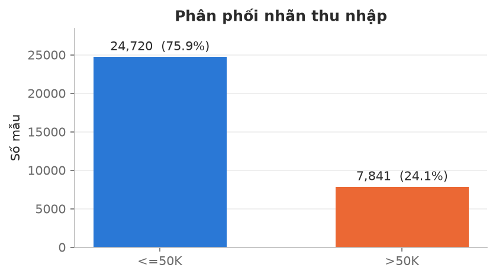

*Hình 3.1. Phân phối nhãn `income` trên toàn bộ dữ liệu. Nguồn: `results/figures/eda/01_income_distribution.png`, `results/eda/label_distribution.csv`.*

**Dữ liệu thiếu.** Dữ liệu không có ô trống NaN. Thay vào đó, giá trị thiếu được ghi bằng ký tự `?` ở ba cột (Bảng 3.1). Tổng cộng có 2.399 dòng chứa ít nhất một giá trị `?`. Điểm đáng chú ý là việc thiếu dữ liệu **có liên quan đến nhãn**: nhóm có `?` có tỉ lệ `>50K` là 13,9%, còn nhóm không có `?` là 24,9%. Như vậy, giá trị thiếu mang thông tin và không nên xóa bỏ các dòng này.

*Bảng 3.1. Số lượng giá trị `?` theo cột. Nguồn: `results/eda/columns_overview.csv`, `results/eda/missing_vs_income.csv`.*

| Cột | Số giá trị `?` | Tỉ lệ (%) |
|---|---:|---:|
| workclass | 1.836 | 5,64 |
| occupation | 1.843 | 5,66 |
| native.country | 583 | 1,79 |

**Thuộc tính số.** Ở lớp `>50K`, giá trị trung bình của các thuộc tính đều cao hơn: tuổi 44,25 so với 36,78; `education.num` 11,61 so với 9,60; số giờ làm việc mỗi tuần 45,47 so với 38,84 (Hình 3.2, 3.3).

`capital.gain` và `capital.loss` lệch rất mạnh:
- 91,67% giá trị `capital.gain` và 95,33% giá trị `capital.loss` bằng 0.
- Độ lệch (skew) của `capital.gain` là 11,95.
- Có 159 dòng mang giá trị `capital.gain = 99999` và **toàn bộ** thuộc lớp `>50K`. Giá trị này trông giống mã chặn trên (top-code) của cuộc điều tra hơn là một số tiền thật. Chúng tôi giữ nguyên các dòng này vì không có căn cứ để sửa.

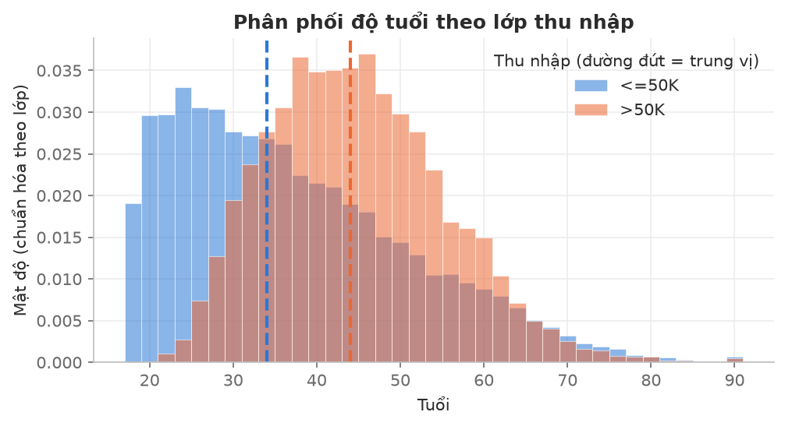

*Hình 3.2. Phân phối tuổi theo lớp thu nhập. Nguồn: `results/figures/eda/02_age.png`.*

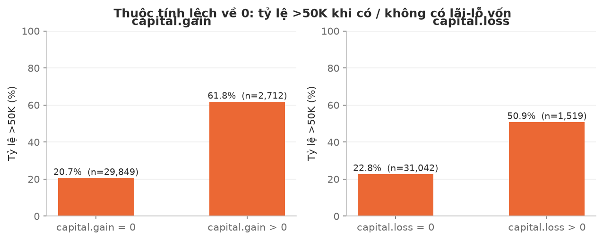

*Hình 3.3. Tỉ lệ `>50K` theo việc `capital.gain`/`capital.loss` bằng 0 hay khác 0. Nguồn: `results/figures/eda/07_capital_zero_vs_nonzero.png`, `results/eda/numeric_summary.csv`, `results/eda/numeric_by_class.csv`.*

**Thuộc tính phân loại.** Tỉ lệ `>50K` thay đổi mạnh theo hạng mục. Ví dụ, trong `marital.status`, nhóm Married-civ-spouse có tỉ lệ 44,7%, còn nhóm Never-married chỉ 4,6%. Trong `workclass`, nhóm Self-emp-inc có tỉ lệ 55,7%, còn nhóm Private là 21,9% (nguồn: `results/eda/category_income_rates.csv`).

**Tương quan và liên hệ giữa các thuộc tính.**
- Giữa các thuộc tính số, tương quan Pearson đều nhỏ, |r| ≤ 0,15 (Hình 3.4).
- Giữa các thuộc tính phân loại, dùng hệ số Cramér's V: `relationship` và `sex` liên hệ mạnh (V = 0,649); `marital.status` và `relationship` có V = 0,488 (Hình 3.5). Đây là bằng chứng cụ thể cho thấy giả định độc lập của Naive Bayes bị vi phạm.
- Theo Mutual Information với nhãn, các thuộc tính mang nhiều thông tin nhất là `relationship` (0,115), `marital.status` (0,109) và `capital.gain` (0,083). Các thuộc tính ít thông tin nhất là `race` (0,006) và `native.country` (0,006) (Hình 3.6).

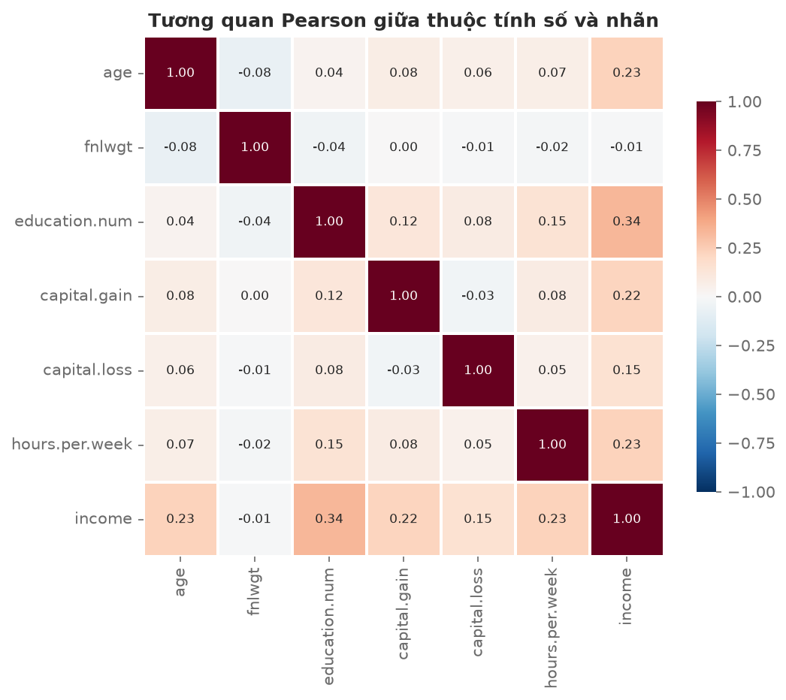

*Hình 3.4. Ma trận tương quan Pearson giữa các thuộc tính số và nhãn. Nguồn: `results/figures/eda/08_corr_numeric_pearson.png`, `results/eda/corr_pearson.csv`.*

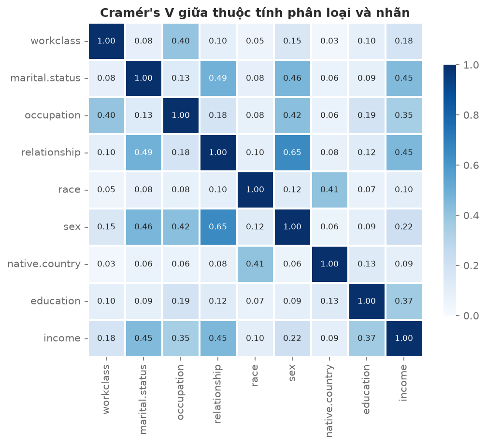

*Hình 3.5. Hệ số Cramér's V giữa các thuộc tính phân loại. Nguồn: `results/figures/eda/09_cramers_v_categorical.png`, `results/eda/cramers_v.csv`.*

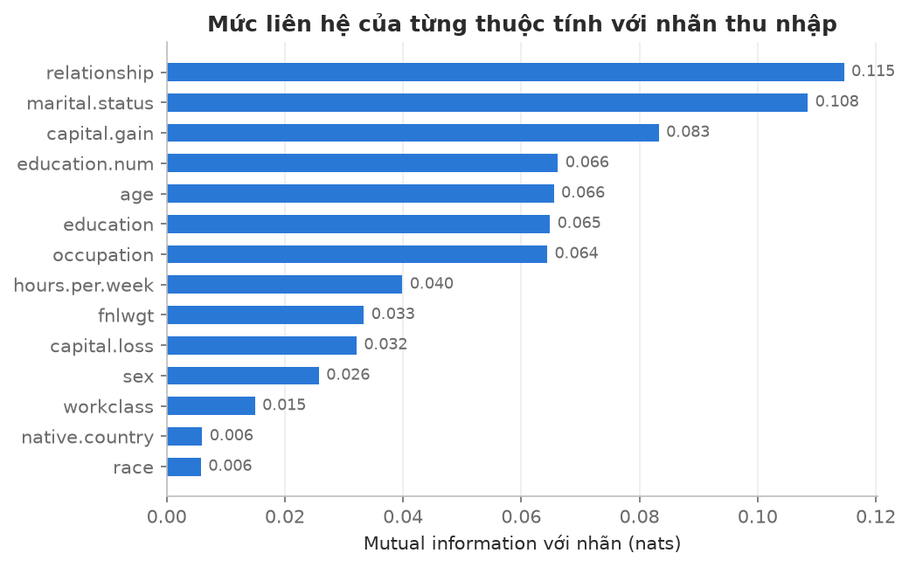

*Hình 3.6. Mutual Information giữa từng thuộc tính và nhãn. Nguồn: `results/figures/eda/10_mutual_information.png`, `results/eda/mutual_info.csv`.*

## 3.3. Tiền xử lý

Mọi bước có tham số cần học (bộ mã hóa, biên rời rạc hóa) đều được đặt trong scikit-learn `Pipeline`. Nhờ vậy, các tham số này **chỉ được học từ dữ liệu đưa vào lệnh fit**: tập Train khi tuning, hoặc Train+Validation khi huấn luyện lần cuối. Thiết kế này ngăn rò rỉ thông tin từ tập Validation hoặc Test.

| Bước | Decision Tree | CategoricalNB |
|---|---|---|
| Giá trị `?` | chuyển thành hạng mục riêng `"Unknown"` (không xóa dòng) | như DT |
| Thuộc tính phân loại (7 cột) | One-Hot Encoding, bỏ qua hạng mục chưa gặp | Ordinal Encoding; hạng mục chưa gặp được gán một mã dành riêng |
| Thuộc tính số `age`, `fnlwgt`, `education.num`, `hours.per.week` | giữ nguyên (cây không cần chuẩn hóa) | rời rạc hóa theo phân vị thành `n_bins` khoảng |
| `capital.gain`, `capital.loss` | giữ nguyên | rời rạc hóa riêng: mã 0 dành cho giá trị = 0; phần giá trị dương chia theo phân vị thành tối đa 4 khoảng |
| Số đặc trưng sau xử lý | 92 | 13 |

*Bảng 3.2. Pipeline tiền xử lý của hai mô hình chính. Nguồn: `src/preprocessing.py`.*

Giải thích các lựa chọn:
- **Bỏ `education`, giữ `education.num`:** hai cột ánh xạ một-một với nhau (16 trình độ tương ứng 16 mã số; đã kiểm tra trong `src/check_design.py`). Giữ cả hai sẽ đưa cùng một thông tin vào mô hình hai lần. Với Naive Bayes, điều đó khiến thông tin này bị "đếm đôi" trong tích xác suất.
- **Rời rạc hóa cho CategoricalNB:** CategoricalNB chỉ nhận giá trị rời rạc. Rời rạc hóa theo phân vị giúp mỗi khoảng có số mẫu gần bằng nhau. Số khoảng `n_bins` là một siêu tham số được tuning.
- **Xử lý riêng giá trị 0 của capital:** vì hơn 90% giá trị bằng 0, rời rạc hóa theo phân vị thông thường sẽ gộp toàn bộ cột thành một khoảng duy nhất, làm mất thông tin. Bộ rời rạc hóa riêng (`ZeroInflatedDiscretizer`) tách nhóm "= 0" ra và chỉ chia phần giá trị dương.
- **Không dùng SMOTE:** dự án không thử SMOTE. Mất cân bằng lớp được xử lý bằng cơ chế sẵn có của từng thuật toán: `class_weight` cho Decision Tree và `fit_prior` cho Naive Bayes. Cả hai lựa chọn này đều được tuning trên Validation. Có ba lý do cho thiết kế này:
  1. SMOTE sinh mẫu tổng hợp bằng nội suy trong không gian đặc trưng số. Cách này không tự nhiên với dữ liệu có nhiều thuộc tính phân loại như Adult.
  2. Nếu dùng sai chỗ, SMOTE có thể gây rò rỉ dữ liệu, vì nó chỉ được phép áp dụng bên trong tập Train.
  3. Dùng cơ chế gốc của từng thuật toán giữ cho phép so sánh "thuần" hai thuật toán.

  Đây là lựa chọn thiết kế, không phải kết luận rằng SMOTE kém hơn.
- **Không xóa bản ghi trùng lặp:** dữ liệu có các bản ghi trùng lặp. Thay vì xóa tùy tiện, dự án giữ nguyên dữ liệu và xử lý ở bước chia tập (mục 3.4).

## 3.4. Chia tập dữ liệu

*Bảng 3.3. Kích thước và phân phối nhãn của ba tập. Nguồn: `data/processed/split_summary.csv`.*

| Tập | Số mẫu | Tỉ lệ | `<=50K` | `>50K` | Tỉ lệ `>50K` |
|---|---:|---:|---:|---:|---:|
| Train | 22.793 | 70% | 17.304 | 5.489 | 0,2408 |
| Validation | 4.884 | 15% | 3.708 | 1.176 | 0,2408 |
| Test | 4.884 | 15% | 3.708 | 1.176 | 0,2408 |
| **Tổng** | **32.561** | | | | |

**Phương pháp.**
1. Mỗi bản ghi được gán một mã nhóm. Các bản ghi trùng nhau **toàn bộ 15 cột** (kể cả nhãn) nhận cùng mã nhóm. Có 23 nhóm trùng như vậy.
2. Dữ liệu được chia bằng `StratifiedGroupKFold` (20 fold, `shuffle=True`, `random_state=42`). Fold 0–2 thành tập Test, fold 3–5 thành tập Validation, 14 fold còn lại thành tập Train.

Cách chia này đạt hai mục tiêu cùng lúc:
- **Phân tầng:** tỉ lệ `>50K` ở cả ba tập đều bằng 0,2408.
- **Không tách nhóm:** một bản ghi và bản sao của nó không thể nằm ở hai tập khác nhau. Nếu điều đó xảy ra, mô hình sẽ được "thấy trước" một phần tập kiểm tra.

**Vai trò của từng tập.**
- **Train:** huấn luyện mô hình trong giai đoạn tuning.
- **Validation:** so sánh các cấu hình siêu tham số và chọn cấu hình tốt nhất.
- **Test:** chỉ dùng **một lần** ở cuối để ước lượng hiệu năng trên dữ liệu mới. Tập Test không tham gia vào bất kỳ quyết định thiết kế nào.

Sau khi chọn xong cấu hình, toàn bộ pipeline (cả tiền xử lý lẫn mô hình) được **fit lại** trên Train+Validation (27.677 mẫu), rồi mới đánh giá trên Test.

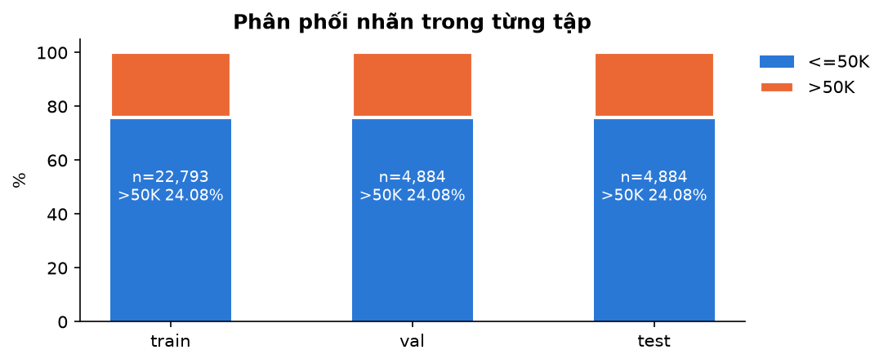

*Hình 3.7. Phân phối nhãn trên ba tập Train/Validation/Test. Nguồn: `results/figures/preprocessing/split_label_distribution.png`.*

## 3.5. Thiết kế thực nghiệm

- **Hai mô hình chính:** Decision Tree và CategoricalNB, mỗi mô hình có pipeline riêng (Bảng 3.2). GaussianNB chỉ dùng 6 thuộc tính số và được báo cáo tách riêng như một thí nghiệm bổ sung.
- **Chọn siêu tham số:** dùng grid search (tìm kiếm lưới) trên Validation. Mỗi cấu hình được fit trên Train và đánh giá trên Validation. **Mọi** cấu hình đã thử đều được ghi vào file CSV.
- **Tiêu chí chọn:** F1 của lớp `>50K` trên Validation. Khi hai cấu hình có F1 bằng nhau, lần lượt xét: AP cao hơn; với DT, cây có ít lá hơn; cuối cùng là thứ tự cấu hình.
- **Ngưỡng:** 0,5, cố định. Ngưỡng **không** được điều chỉnh trên Validation hay Test.
- **Đánh giá cuối:** fit lại trên Train+Validation, dự đoán Test đúng một lần cho mỗi mô hình. Script tự động dừng nếu file dự đoán Test đã tồn tại, để tránh đánh giá lại.

---

# CHƯƠNG 4. CÀI ĐẶT VÀ KẾT QUẢ THỰC NGHIỆM

## 4.1. Môi trường thực nghiệm

- Hệ điều hành Windows 11 (10.0.26300); Python 3.12.10; scikit-learn 1.9.0; pandas 3.1.1; numpy 2.4.4.
- Toàn bộ thực nghiệm chạy **trên CPU của máy cá nhân**, trong một tiến trình. Không dùng GPU, cloud hay dịch vụ bên ngoài.
- Seed ngẫu nhiên là 42 cho việc chia dữ liệu, cho Decision Tree và cho bootstrap.

Nguồn: `results/metrics/best_configs.json`, `results/metrics/final_run_info.json`.

## 4.2. Cấu hình Decision Tree được chọn

`criterion = entropy`, `max_depth = 12`, `min_samples_leaf = 10`, `min_samples_split = 2`, `class_weight = balanced`.

Cây cuối cùng được huấn luyện trên Train+Validation có **365 lá** và độ sâu 12. Nguồn: `results/metrics/final_run_info.json`.

## 4.3. Cấu hình Categorical Naive Bayes được chọn

`n_bins = 20`, `alpha = 0,1`, `fit_prior = True`.

GaussianNB (bổ sung): `var_smoothing = 1e-7`.

## 4.4. Quá trình tuning

*Bảng 4.1. Không gian tìm kiếm. Nguồn: `src/decision_tree.py`, `src/naive_bayes.py`, `results/reports/phase4_summary.md`.*

| Mô hình | Lưới tìm kiếm | Số cấu hình |
|---|---|---:|
| Decision Tree | criterion {gini, entropy} × max_depth {3, 4, 5, 6, 8, 10, 12, 15, 20, None} × min_samples_split {2, 10, 50, 100} × min_samples_leaf {1, 5, 10, 20, 50} × class_weight {None, balanced} | 800 |
| CategoricalNB | n_bins {5, 8, 10, 15, 20, 25, 30, 40, 50} × alpha {0,01; 0,1; 0,5; 1; 2; 5; 10} × fit_prior {True, False} | 126 |
| GaussianNB (bổ sung) | var_smoothing {1e-9, …, 1e-3} | 7 |

**Mở rộng lưới của CNB.** Lưới ban đầu của CNB chỉ gồm n_bins ∈ {5, 8, 10, 15, 20}, tức 70 cấu hình. Cấu hình tốt nhất rơi đúng vào biên n_bins = 20, nên lưới được mở rộng thêm {25, 30, 40, 50}, lên 126 cấu hình. Việc mở rộng chỉ dựa trên Validation. Kết quả không đổi: n_bins = 20 vẫn tốt nhất. Lưới cũ được lưu tại `results/metrics/archive/`.

**Nhận xét từ quá trình tuning** (nguồn: `results/metrics/*_validation_grid.csv`):
- **DT, độ sâu:** F1 tốt nhất trên Validation tăng dần từ max_depth = 5 (0,6576) lên đỉnh tại max_depth = 12 (0,6796), sau đó giảm nhẹ: 0,6766 ở độ sâu 15 và 0,6727 khi không giới hạn (Hình 4.1).
- **DT, quá khớp:** cây gini không giới hạn số mẫu ở lá đạt F1 trên Train gần 1,0 (0,9999), nhưng F1 trên Validation chỉ khoảng 0,60 (Hình 4.2). Đây là minh họa trực tiếp cho hiện tượng quá khớp và cho vai trò của các tham số điều khiển độ phức tạp.
- **DT, xử lý mất cân bằng:** `class_weight = balanced` cho kết quả tốt hơn không dùng trọng số (F1 tốt nhất 0,6796 so với 0,6738). Entropy và gini cho kết quả gần nhau (0,6796 so với 0,6786).
- **CNB:** F1 gần như không nhạy với α (0,6711–0,6733) và với n_bins ≥ 15 (0,6708–0,6733). `fit_prior = True` tốt hơn tiên nghiệm đều (0,6733 so với 0,6542).

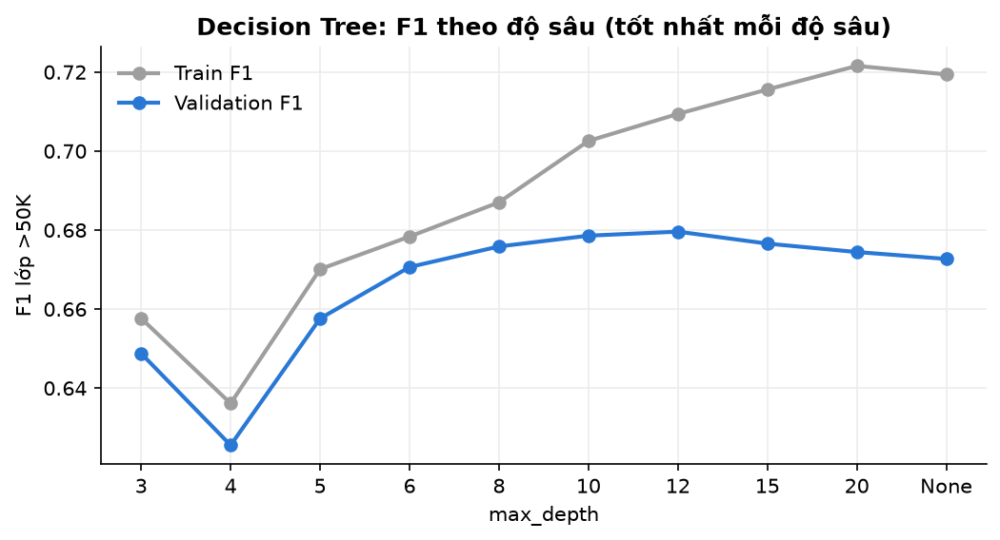

*Hình 4.1. F1 (lớp >50K) tốt nhất trên Train và Validation theo `max_depth` của Decision Tree. Nguồn: `results/figures/validation/dt_f1_vs_depth.png`.*

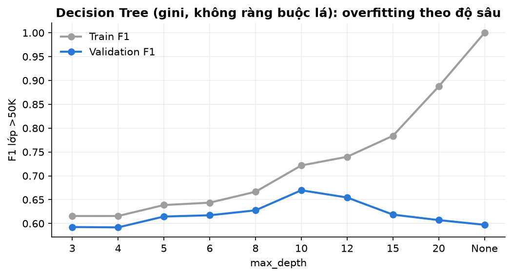

*Hình 4.2. Quá khớp của Decision Tree (gini, không ràng buộc số mẫu ở lá) khi tăng độ sâu. Nguồn: `results/figures/validation/dt_overfitting_default_stopping.png`.*

## 4.5. Kết quả trên Validation

*Bảng 4.2. Kết quả trên Validation; mô hình fit trên Train (22.793 mẫu), ngưỡng 0,5. Nguồn: `results/metrics/validation_comparison.csv`.*

| Chỉ số | Decision Tree | CategoricalNB | GaussianNB (bổ sung) | Luôn đoán `<=50K` |
|---|---:|---:|---:|---:|
| Accuracy | 0,8073 | 0,8172 | 0,7920 | 0,7592 |
| Precision | 0,5667 | 0,5909 | 0,6562 | 0 |
| Recall | 0,8486 | 0,7823 | 0,2857 | 0 |
| **F1** | **0,6796** | **0,6733** | 0,3981 | 0 |
| ROC-AUC | 0,8927 | 0,9004 | 0,7517 | 0,5 |
| AP | 0,7623 | 0,7584 | 0,5515 | 0,2408 |
| TN / FP / FN / TP | 2945 / 763 / 178 / 998 | 3071 / 637 / 256 / 920 | 3532 / 176 / 840 / 336 | 3708 / 0 / 1176 / 0 |

## 4.6. Kết quả trên Test

*Bảng 4.3. Kết quả trên Test (4.884 mẫu, 1.176 mẫu `>50K`); mô hình fit trên Train+Validation (27.677 mẫu), ngưỡng 0,5. Nguồn: `results/metrics/final_test_metrics.csv`; đã được tính lại độc lập từ `results/metrics/final_predictions.csv` trong quá trình kiểm toán.*

| Chỉ số | Decision Tree | CategoricalNB | GaussianNB (bổ sung) |
|---|---:|---:|---:|
| Accuracy | 0,8022 | 0,8176 | 0,8006 |
| Precision | 0,5576 | 0,5907 | 0,6741 |
| Recall | 0,8639 | 0,7891 | 0,3325 |
| **F1** | **0,6778** | **0,6756** | 0,4453 |
| ROC-AUC | 0,8984 | 0,9011 | 0,7840 |
| AP | 0,7715 | 0,7665 | 0,6013 |
| TN / FP / FN / TP | 2902 / 806 / 160 / 1016 | 3065 / 643 / 248 / 928 | 3519 / 189 / 785 / 391 |
| Thời gian fit (s)¹ | 0,250 | 0,134 | 0,006 |
| Thời gian dự đoán Test (s)¹ | 0,017 | 0,014 | 0,001 |

¹ Số đo từ một lần chạy duy nhất, chỉ mang tính tham khảo về bậc độ lớn.

Hai mô hình chính đều có Accuracy cao hơn mốc tham chiếu "luôn đoán `<=50K`" (0,7592 trên Test, vì tỉ lệ `<=50K` của Test bằng của Validation). Chúng cũng vượt xa GaussianNB về F1. Kết quả kém của GaussianNB phù hợp với EDA: GaussianNB thiếu toàn bộ thuộc tính phân loại, và `capital.gain`/`capital.loss` lệch mạnh, rất xa phân phối chuẩn.

**So sánh Validation và Test** (Hình 4.3): mọi chênh lệch giữa Validation và Test đều nhỏ hơn 0,01. Ví dụ, F1 của DT là 0,6796 trên Validation và 0,6778 trên Test; F1 của CNB là 0,6733 và 0,6756. Không thấy dấu hiệu cấu hình được chọn bị "khớp quá mức" với Validation. Về quá khớp: F1 của DT trên Train+Validation là 0,707, trên Test là 0,678; với CNB, hai giá trị là 0,678 và 0,676 (nguồn: `results/metrics/final_run_info.json`). Khoảng cách của DT lớn hơn một chút nhưng vẫn nhỏ.

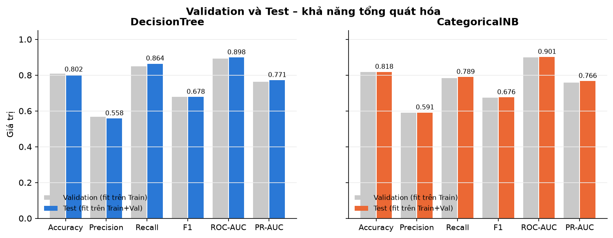

*Hình 4.3. So sánh chỉ số trên Validation (fit trên Train) và Test (fit trên Train+Validation). Nhãn "PR-AUC" trong hình là **Average Precision**. Nguồn: `results/figures/final/validation_vs_test.png`, `results/metrics/validation_vs_test.csv`.*

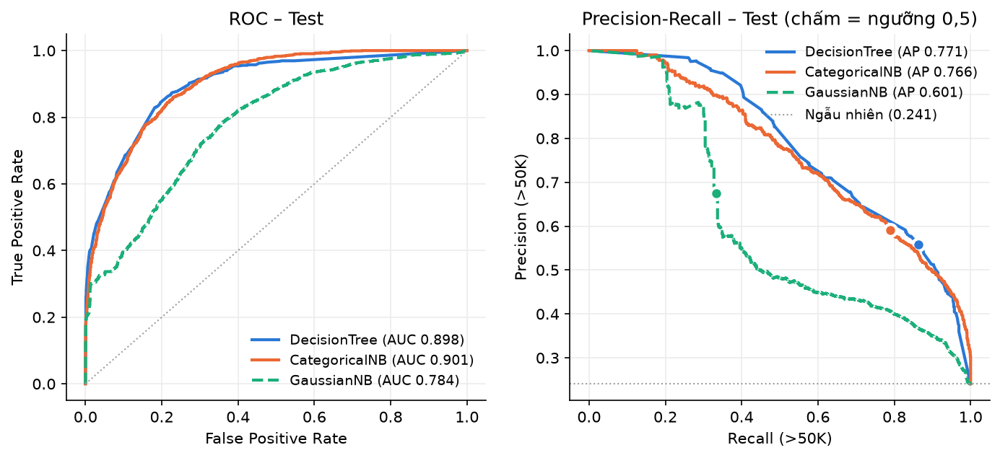

*Hình 4.4. Đường ROC (trái) và đường Precision-Recall (phải) trên Test; chấm tròn đánh dấu điểm làm việc tại ngưỡng 0,5. Số "AP" trong chú giải là Average Precision. Nguồn: `results/figures/final/roc_pr_test.png`.*

Hình 4.4 cho thấy đường ROC của DT và CNB gần như chồng lên nhau. Trên đường Precision-Recall, điểm làm việc của DT nằm về phía Recall cao, còn điểm làm việc của CNB nằm về phía Precision cao hơn. Đường của DT có dạng bậc thang rõ rệt, vì cây chỉ cho ra 161 giá trị xác suất khác nhau trên Test.

## 4.7. Phân tích Confusion Matrix

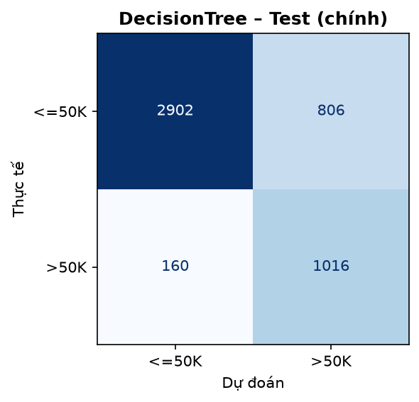

*Hình 4.5a. Confusion Matrix của Decision Tree trên Test. Nguồn: `results/figures/final/cm_test_DecisionTree.png`.*

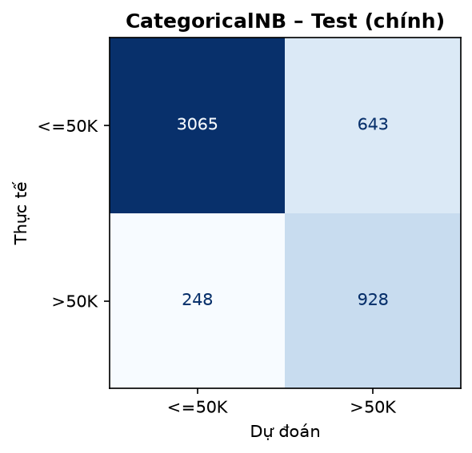

*Hình 4.5b. Confusion Matrix của CategoricalNB trên Test. Nguồn: `results/figures/final/cm_test_CategoricalNB.png`.*

Trong 1.176 người thật sự có thu nhập `>50K`:
- **DT** phát hiện đúng 1.016 người (TP) và bỏ sót 160 người (FN), tương ứng Recall 0,864.
- **CNB** phát hiện đúng 928 người và bỏ sót 248 người, tương ứng Recall 0,789.

Trong 3.708 người có thu nhập `<=50K`:
- **DT** dự đoán nhầm 806 người thành `>50K` (FP).
- **CNB** chỉ dự đoán nhầm 643 người.

Như vậy, so với CNB, DT phát hiện thêm 88 người `>50K` nhưng đổi lại có thêm 163 dự đoán nhầm.

## 4.8. Phân tích sự đánh đổi

- **Decision Tree có Recall cao hơn** (0,864 so với 0,789). Nguyên nhân chính là `class_weight = balanced`: trọng số này làm cây "ưu tiên" lớp thiểu số, nên ở ngưỡng 0,5 cây dự đoán `>50K` nhiều hơn.
- **CategoricalNB có Precision và Accuracy cao hơn** (Precision 0,591 so với 0,558; Accuracy 0,818 so với 0,802). Mô hình giữ tiên nghiệm theo tần suất thực (khoảng 76/24), nên dè dặt hơn khi dự đoán `>50K`.
- Hai mô hình có F1 gần như bằng nhau (0,6778 và 0,6756), nhưng **nằm ở hai điểm làm việc khác nhau** trên đường Precision-Recall.

Nên chọn mô hình nào phụ thuộc vào chi phí của từng loại lỗi trong ứng dụng cụ thể. Nếu bỏ sót người `>50K` tốn kém hơn, nên ưu tiên Recall. Nếu dự đoán nhầm tốn kém hơn, nên ưu tiên Precision. Vấn đề này nằm ngoài phạm vi đề tài.

---

# CHƯƠNG 5. SO SÁNH VÀ THẢO LUẬN

## 5.1. So sánh hai mô hình trên các chỉ số

*Bảng 5.1. Chênh lệch giá trị điểm DT − CNB trên Test. Nguồn: Bảng 4.3.*

| Chỉ số | DT | CNB | DT − CNB | Mô hình có giá trị điểm cao hơn |
|---|---:|---:|---:|---|
| Accuracy | 0,8022 | 0,8176 | −0,0154 | CNB |
| Precision | 0,5576 | 0,5907 | −0,0331 | CNB |
| Recall | 0,8639 | 0,7891 | +0,0748 | DT |
| F1 | 0,6778 | 0,6756 | +0,0021 | DT (rất nhỏ) |
| ROC-AUC | 0,8984 | 0,9011 | −0,0027 | CNB (rất nhỏ) |
| AP | 0,7715 | 0,7665 | +0,0050 | DT (rất nhỏ) |

Ở ba chỉ số tổng hợp (F1, ROC-AUC, AP), chênh lệch giá trị điểm đều dưới 0,006, và không mô hình nào hơn ở cả ba. Phần tiếp theo kiểm tra xem các chênh lệch này có vượt quá mức dao động ngẫu nhiên hay không.

## 5.2. Khoảng tin cậy bootstrap 95%

**Thiết lập:** paired stratified bootstrap, 5.000 lần lặp, seed 42, khoảng tin cậy percentile 95%. Quy trình được kiểm toán lại: tính lại độc lập từ các dự đoán đã lưu cho kết quả khớp, sai lệch không quá 2·10⁻¹⁸ (nguồn: `results/reports/final_audit/bootstrap_audit.md`).

*Bảng 5.2. Khoảng tin cậy 95% của từng mô hình trên Test. Nguồn: `results/metrics/bootstrap_confidence_intervals.csv`.*

| Mô hình | F1 | ROC-AUC | AP |
|---|---|---|---|
| Decision Tree | 0,6778 [0,6629; 0,6936] | 0,8984 [0,8879; 0,9085] | 0,7715 [0,7514; 0,7907] |
| CategoricalNB | 0,6756 [0,6585; 0,6929] | 0,9011 [0,8922; 0,9100] | 0,7665 [0,7471; 0,7861] |

*Bảng 5.3. Chênh lệch ghép cặp DT − CNB. Nguồn: `results/metrics/paired_model_comparison.csv`.*

| Chỉ số | Chênh lệch | CI 95% | CI chứa 0? |
|---|---:|---|---|
| F1 | +0,0021 | [−0,0133; +0,0175] | Có |
| ROC-AUC | −0,0027 | [−0,0102; +0,0046] | Có |
| AP | +0,0050 | [−0,0093; +0,0192] | Có |

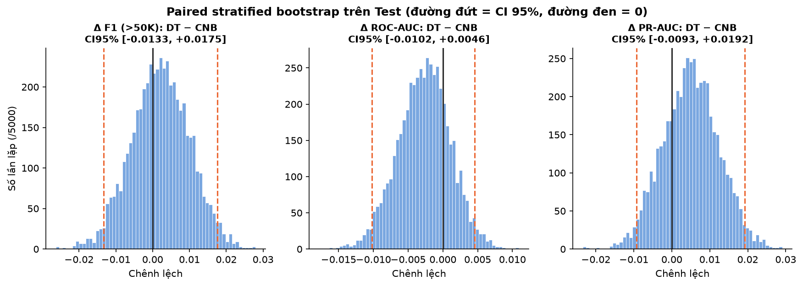

*Hình 5.1. Phân phối bootstrap của chênh lệch DT − CNB. Đường đứt nét là giới hạn của CI 95%, đường đen là giá trị 0. Ô thứ ba có tiêu đề "PR-AUC" là **Average Precision**. Nguồn: `results/figures/final/bootstrap_differences.png`.*

**Diễn giải.**
- Cả ba khoảng tin cậy đều chứa 0. Vì vậy **chưa đủ bằng chứng thống kê** ở mức tin cậy 95% để kết luận Decision Tree hay CategoricalNB tốt hơn về F1, ROC-AUC hoặc AP trên tập Test này.
- Kết quả này **không** có nghĩa hai mô hình tương đương. Nó chỉ cho thấy tập Test với 4.884 mẫu không đủ để phân biệt các chênh lệch nhỏ như vậy. Ví dụ, chênh lệch thật về F1 có thể nằm ở bất kỳ đâu từ khoảng −0,013 đến +0,018.
- Khoảng tin cậy **chỉ phản ánh dao động do lấy mẫu lại tập Test**. Hai mô hình được giữ cố định khi bootstrap. Dao động do dữ liệu huấn luyện, do cách chia tập hay do việc chọn siêu tham số đều không được tính vào.

**Về tên chỉ số AP.** Nếu tính diện tích hình thang dưới đường Precision-Recall, DT đạt 0,7840 thay vì AP 0,7715, còn CNB đạt 0,7664 thay vì 0,7665. Hai cách tính chênh lệch nhau đáng kể ở DT vì xác suất của DT chỉ có ít giá trị khác nhau, và phép nội suy tuyến tính của cách hình thang cho kết quả lạc quan quá mức. Báo cáo dùng AP, đúng với giá trị đã được tính và lựa chọn trước khi xem Test. Báo cáo không đổi sang cách tính hình thang sau khi đã xem kết quả.

## 5.3. Kiểm định McNemar (phân tích bổ sung)

*Bảng 5.4. Bảng 2×2 giữa dự đoán đúng/sai của hai mô hình trên Test. Nguồn: `results/reports/final_audit/mcnemar_audit.md`.*

| | CNB đúng | CNB sai |
|---|---:|---:|
| **DT đúng** | 3.654 | b = 264 |
| **DT sai** | c = 339 | 627 |

- **Phương pháp:** exact binomial McNemar, hai phía. Kết quả **p = 0,0025538**. Để đối chiếu: χ² không hiệu chỉnh cho p = 0,00226; χ² có hiệu chỉnh liên tục cho p = 0,00258.
- **Kết luận:** tại ngưỡng 0,5, hai mô hình có Accuracy khác nhau có ý nghĩa thống kê. CategoricalNB đúng ở 339 mẫu mà DT sai, trong khi DT chỉ đúng ở 264 mẫu mà CNB sai. Vì vậy **CategoricalNB có Accuracy cao hơn**.
- **Giới hạn của kết luận:**
  - Đây là **phân tích bổ sung**, không thuộc tiêu chí đánh giá đã định trước. Tiêu chí định trước là các khoảng tin cậy bootstrap ở mục 5.2.
  - Kiểm định chỉ nói về **Accuracy tại ngưỡng 0,5**. Khác biệt Accuracy này chủ yếu do DT dự đoán `>50K` nhiều hơn (FP 806 so với 643), tức là do hai mô hình chọn điểm làm việc khác nhau.
  - **Không** được dùng kết quả McNemar để khẳng định CategoricalNB tốt hơn về mọi mặt. Về F1, ROC-AUC và AP, dữ liệu chưa ủng hộ kết luận đó.

## 5.4. Kiểm toán dữ liệu và độ tin cậy của kết quả

Sau khi đánh giá xong, toàn bộ kết quả được kiểm toán ở chế độ chỉ đọc: không fit lại, không dự đoán lại. Kết quả kiểm toán: 61 mục PASS, 4 mục WARNING, 0 mục FAIL. Các kết quả chính được bốn tác tử kiểm tra độc lập tính lại và cho ra cùng số liệu (nguồn: `results/reports/final_audit/FINAL_AUDIT_REPORT.md`).

**Trùng lặp theo 14 đặc trưng** (không tính nhãn), nguồn `results/reports/final_audit/duplicate_audit.csv`:
- Có **24 tổ hợp đặc trưng bị trùng**, gồm 49 dòng. **Không có tổ hợp nào** xuất hiện đồng thời ở hai tập trong số Train, Validation, Test.
- Có **một cặp** dòng cùng 14 đặc trưng nhưng khác nhãn: **dòng 4963** (`<=50K`) và **dòng 24061** (`>50K`). Cả hai đều nằm trong **Train**. Đây là sự không nhất quán nhãn có sẵn trong dữ liệu gốc. Không đủ căn cứ để khẳng định nguyên nhân là lỗi gán nhãn: hai người khác nhau hoàn toàn có thể có cùng hồ sơ nhưng thu nhập khác nhau.
- **Hạn chế về thiết kế:** cách chia dữ liệu gom nhóm theo 15 cột, tức là tính cả nhãn. Vì vậy, về nguyên tắc, cách chia này không bảo đảm hai dòng cùng đặc trưng nhưng khác nhãn sẽ luôn nằm cùng một tập. Ở lần chia hiện tại, kiểm toán xác nhận không có tổ hợp nào bị giao giữa các tập, nên kết quả thực nghiệm không bị ảnh hưởng.

**Tính toàn vẹn.** Kiểm toán xác nhận các điểm sau:
- Các tập chia khớp với file đã khóa.
- File dự đoán có đúng 4.884 dòng, và nhãn khớp với dữ liệu gốc.
- Mọi chỉ số và Confusion Matrix tính lại từ dự đoán đã lưu đều khớp với file kết quả.
- Mã băm của dữ liệu gốc và của các mô hình không đổi.
- Lần chạy đầu tiên của bước đánh giá cuối bị lỗi, nhưng lỗi xảy ra **trước** khi chạm vào tập Test.

## 5.5. Hạn chế

1. **Dữ liệu lịch sử.** Adult được trích từ điều tra dân số Hoa Kỳ năm 1994. Ngưỡng 50.000 USD, cơ cấu nghề nghiệp và mức lương đều đã thay đổi. Kết quả không thể khái quát cho bối cảnh hiện nay hay cho quốc gia khác, kể cả Việt Nam.
2. **Mất cân bằng lớp** (khoảng 24% `>50K`). Accuracy dễ gây hiểu lầm, và kết quả phụ thuộc vào ngưỡng 0,5 đã cố định.
3. **Nhãn không nhất quán:** có một cặp bản ghi cùng đặc trưng nhưng khác nhãn (mục 5.4).
4. **Chỉ có một lần chia dữ liệu và một tập Test.** Kết quả có thể thay đổi với cách chia khác.
5. **Phạm vi của bootstrap:** khoảng tin cậy không phản ánh toàn bộ biến động của quá trình huấn luyện và chia tập.
6. **Công bằng thuật toán:** dữ liệu chứa các thuộc tính nhạy cảm như `sex` và `race`, và `relationship` liên hệ mạnh với `sex`. Mô hình có thể tái tạo các bất bình đẳng có trong dữ liệu lịch sử. Báo cáo không phân tích công bằng và **không** rút ra kết luận nhân quả nào, chẳng hạn "giới tính gây ra thu nhập cao".
7. **Không phù hợp cho quyết định thực tế:** mô hình **không** được dùng cho tuyển dụng, cho vay hay bất kỳ quyết định nào có tác động lớn đến cá nhân.

---

# KẾT LUẬN VÀ HƯỚNG PHÁT TRIỂN

## Kết luận

1. Dự án đã xây dựng và đánh giá hai mô hình độc lập là Decision Tree và Categorical Naive Bayes trên bộ dữ liệu Adult Census Income. Quy trình bao gồm: chia dữ liệu theo nhóm trùng lặp để chống rò rỉ, chọn siêu tham số trên Validation với 800 cấu hình DT và 126 cấu hình CNB, và đánh giá Test đúng một lần.
2. Trên Test, cả hai mô hình đều có Accuracy (0,8022 và 0,8176) cao hơn mốc tham chiếu "luôn đoán `<=50K`" (khoảng 0,7592).
3. F1 của lớp `>50K` của hai mô hình rất gần nhau: DT đạt 0,6778, CNB đạt 0,6756. Khoảng tin cậy bootstrap 95% của chênh lệch đều chứa 0 ở cả F1, ROC-AUC và AP. Vì vậy **chưa đủ bằng chứng để kết luận mô hình nào tốt hơn** theo tiêu chí đã định trước. Đồng thời, kết quả này cũng không chứng minh hai mô hình tương đương.
4. Hai mô hình có cách đánh đổi khác nhau: DT có Recall cao hơn nhưng nhiều FP hơn; CNB có Precision và Accuracy cao hơn nhưng bỏ sót nhiều trường hợp `>50K` hơn. Kiểm định McNemar (phân tích bổ sung, p = 0,0026) xác nhận khác biệt về Accuracy tại ngưỡng 0,5.
5. Kết quả thực nghiệm mang lại một số bài học cụ thể:
   - Cây quyết định không giới hạn bị quá khớp rõ rệt (F1 trên Train khoảng 1,0 nhưng trên Validation chỉ khoảng 0,60).
   - CategoricalNB, dù giả định độc lập bị vi phạm, vẫn cạnh tranh được với Decision Tree khi các thuộc tính số được rời rạc hóa phù hợp.
   - Bước kiểm toán độc lập giúp phát hiện và làm rõ các điểm dễ diễn giải sai, như tên chỉ số AP và vai trò của McNemar, trước khi viết báo cáo.

## Hướng phát triển

1. Đánh giá bằng **cross-validation lặp lại, có phân tầng và tôn trọng nhóm** (repeated stratified group k-fold), để ước lượng cả dao động do cách chia dữ liệu.
2. Mở rộng so sánh sang SVM hoặc mạng nơ-ron nếu có điều kiện, như các mô hình tham chiếu bổ sung.
3. **Phân tích công bằng** (fairness): so sánh các chỉ số lỗi theo nhóm `sex` và `race`.
4. **Giải thích mô hình:** phân tích mức độ quan trọng của đặc trưng (feature importance) của cây và xác suất có điều kiện của Naive Bayes.
5. **Khảo sát ngưỡng phân loại** theo mục tiêu ứng dụng. Việc chọn ngưỡng phải thực hiện trên Validation, không được điều chỉnh theo Test.

---

# TÀI LIỆU THAM KHẢO

[1] J. R. Quinlan, "Induction of decision trees," *Machine Learning*, vol. 1, no. 1, pp. 81–106, 1986.

[2] L. Breiman, J. H. Friedman, R. A. Olshen, and C. J. Stone, *Classification and Regression Trees*. Belmont, CA: Wadsworth, 1984.

[3] R. Kohavi, "Scaling up the accuracy of Naive-Bayes classifiers: A decision-tree hybrid," in *Proc. 2nd Int. Conf. Knowledge Discovery and Data Mining (KDD-96)*, 1996, pp. 202–207.

[4] B. Becker and R. Kohavi, "Adult," UCI Machine Learning Repository, 1996. doi: 10.24432/C5XW20.

[5] P. Domingos and M. Pazzani, "On the optimality of the simple Bayesian classifier under zero-one loss," *Machine Learning*, vol. 29, no. 2–3, pp. 103–130, 1997.

[6] B. Efron and R. J. Tibshirani, *An Introduction to the Bootstrap*. New York: Chapman & Hall, 1993.

[7] Q. McNemar, "Note on the sampling error of the difference between correlated proportions or percentages," *Psychometrika*, vol. 12, no. 2, pp. 153–157, 1947.

[8] T. G. Dietterich, "Approximate statistical tests for comparing supervised classification learning algorithms," *Neural Computation*, vol. 10, no. 7, pp. 1895–1923, 1998.

[9] F. Pedregosa *et al.*, "Scikit-learn: Machine learning in Python," *Journal of Machine Learning Research*, vol. 12, pp. 2825–2830, 2011.

[10] scikit-learn developers, "scikit-learn User Guide: 1.9 Naive Bayes; 1.10 Decision Trees; 3.4 Metrics and scoring," https://scikit-learn.org/stable/user_guide.html. [CẦN XÁC MINH NGUỒN: số mục và ngày truy cập cho phiên bản 1.9.0]

[11] T. Saito and M. Rehmsmeier, "The precision-recall plot is more informative than the ROC plot when evaluating binary classifiers on imbalanced datasets," *PLoS ONE*, vol. 10, no. 3, e0118432, 2015.

[12] T. M. Mitchell, *Machine Learning*. New York: McGraw-Hill, 1997.

[13] C. D. Manning, P. Raghavan, and H. Schütze, *Introduction to Information Retrieval*. Cambridge, U.K.: Cambridge University Press, 2008.

Tình trạng xác minh của từng tài liệu được ghi trong `REFERENCES.md`.

---

# PHỤ LỤC A. DANH MỤC FILE KẾT QUẢ

| Nội dung | File |
|---|---|
| Chia tập | `data/processed/split_indices.csv`, `split_summary.csv` |
| EDA | `results/eda/*.csv`, `results/figures/eda/*.png`, `notebooks/01_EDA.ipynb` |
| Tuning | `results/metrics/*_validation_grid.csv`, `best_configs.json`, `validation_comparison.csv`, `results/reports/phase4_summary.md` |
| Đánh giá Test | `results/metrics/final_test_metrics.csv`, `final_predictions.csv`, `bootstrap_confidence_intervals.csv`, `paired_model_comparison.csv`, `final_run_info.json`, `results/reports/final_evaluation.md` |
| Mô hình | `results/models/final/*.joblib` |
| Kiểm toán | `results/reports/final_audit/` |
| Mã nguồn | `src/*.py`, `scripts/*.py` |
